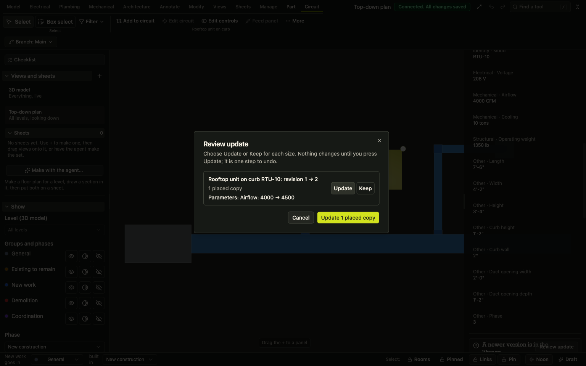

# Reuse RTU-10 across two projects

Project A contains a drawn rooftop unit in three sizes. Project B has a Roof level where you can place one. Each demo runs its own in-memory model and opens the same local SQLite catalog.

1. From the repository root, run `npm ci`. In terminal A, create a fresh catalog directory and copy the printed path for terminal B.

   ```sh
   export BIM_DEV_FIRM_PARTS_DB="$(mktemp -d)/parts.sqlite"
   echo "$BIM_DEV_FIRM_PARTS_DB"
   BIM_DEV_MODEL=firm-parts-a BIM_DEV_PORT=3095 node --import tsx packages/bim-devserver/src/server.ts
   ```

2. Open the editor URL printed by A. Under **Model → Place part**, search for **RTU-10** and open its edit control. Choose **Publish… → Publish revision 1**. The family includes RTU-5, RTU-10 and RTU-15. Stop A with Ctrl+C and rerun its last command in the same terminal.

3. From the repository root in terminal B, substitute the catalog path printed in step 1 and start the second project.

   ```sh
   BIM_DEV_FIRM_PARTS_DB="/absolute/path/from/terminal-A/parts.sqlite" BIM_DEV_MODEL=firm-parts-b BIM_DEV_PORT=3096 node --import tsx packages/bim-devserver/src/server.ts
   ```

4. Open B’s printed URL. Under **Model → Place part**, search for **RTU-10**, choose the firm library entry and click an empty spot on the Roof plan. The placed unit shows **4,000 CFM**. Keep B’s server running to retain this placement.

5. Reopen A’s editor. Edit RTU-10, open **Parameters**, change the RTU-10 row’s airflow to **4,500 CFM**, then publish revision 2. Refresh B’s browser tab, select the placed unit and choose **Review update**. The dialog offers one copy and shows **Airflow: 4000 → 4500**. **Keep** or **Cancel** leaves the current copy in place. **Update 1 placed copy** applies the new type in one undoable change and preserves its position.



The catalog persists across server restarts. To exercise a lost publish reply and competing saves against real demo processes, run the focused checks from the repository root.

```sh
npm test -- --runInBand --runTestsByPath packages/bim-devserver/__tests__/firm-part-restart.test.ts packages/bim-devserver/__tests__/firm-part-store.test.ts packages/bim-editor/__tests__/firm-part-publishing.test.tsx
```
